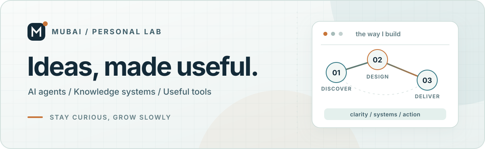

<!--
  木白 · Mubai — GitHub Profile
  主页内容坚持：真实、克制、可维护。视觉资源位于 assets/。
-->

  <picture>
    <source media="(prefers-color-scheme: dark)" srcset="./assets/hero-dark.svg" />
    
  </picture>

### 木白 · Mubai

**保持好奇，慢慢生长。**

喜欢写代码，也喜欢把想法慢慢做成真正好用的小工具。

[GitHub](https://github.com/Fongcy) · [Worklog 在线演示](https://worklog.nuoya.icu/)

---

## 01 / 关于我 · About

你好，我是 **木白（Mubai）**。喜欢研究如何把模糊的问题变成清晰的流程，再把这些流程打磨成简单、可靠的工具。

我关注的不只是「模型能做什么」，更是 **人在什么时候参与、系统如何给出依据、出错以后如何继续**。从 AI Agent 到个人知识管理，我希望技术最终能减少认知负担，而不是制造新的复杂性。

> **Less noise. More clarity. Better tools.**

## 02 / 现在在做 · Now building

### Worklog · 工作复盘台

**让零散的工作事项，成为可核对、可修订、可回看的日报与周报。**

- **工作记录**：围绕日期整理事项，支持修改、归档与恢复。
- **报告复盘**：从选定材料生成演示草稿，核对来源后编辑、保存与导出。
- **历史回看**：按类型、状态和内容查找记录，保留生成报告时的来源快照。

**当前阶段：** v0.2 交互原型 · React / TypeScript / Vite · 以本地浏览器数据为主。

**能力边界：** 当前报告整理采用固定规则演示，尚未接入真实 AI 模型或后端；不将原型功能描述为已上线的智能能力。

**[查看 Worklog 在线演示 →](https://worklog.nuoya.icu/)**

项目仍在迭代。此处展示公开可介绍的产品信息，不公开私有仓库内容。

## 03 / 探索方向 · Areas of interest

| AI Agent & Workflows | Knowledge Systems | Thoughtful Tools |
| :--- | :--- | :--- |
| 工具调用、任务编排、人机协作与失败恢复。 | Obsidian、RAG、知识检索和持续学习。 | 小而专注的应用、清晰交互和可靠工程。 |
| **让智能体可理解、可干预。** | **让知识可积累、可再次使用。** | **让复杂能力自然地服务于人。** |

## 04 / 技术与方法 · Toolkit

**日常构建**

**数据、工具与知识工作流**

**持续探索：** LLM Applications · Agent Orchestration · Human-in-the-loop · RAG

这里区分实际使用的工具和正在探索的方向，不代表对每项技术的熟练程度排名。

## 05 / 我相信的工作方式 · Principles

- **从问题开始。** 先确认要解决什么，再决定是否需要 AI。
- **让过程可核对。** 重要结果有来源、状态与清晰的能力边界。
- **允许人随时接管。** 好的自动化需要暂停、修正和恢复的路径。
- **用小步交付验证价值。** 功能可以简单，体验与工程质量不能将就。

---

  <strong>保持好奇，慢慢生长。</strong>

  
Mubai · @Fongcy · Stay curious, grow slowly.

  <a href="https://github.com/Fongcy">关注 GitHub</a> · <a href="https://github.com/Fongcy/Fongcy/issues">交流想法</a>

