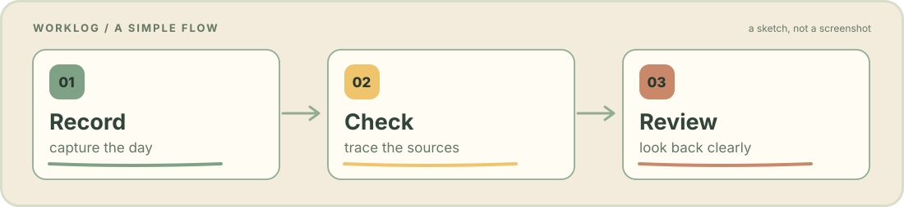

<!-- 木白 · Mubai | GitHub Profile -->

  <picture>
    <source media="(prefers-color-scheme: dark)" srcset="./assets/little-corner-dark.svg" />
    
  </picture>

  <h3>你好，我是木白。 Mubai</h3>
  
热衷于 AI Agent 与新的研发方式。喜欢琢磨上下文工程、Harness 工程和自主智能体，也想让人与 AI 一起把想法更快、更稳地变成作品。

  
<strong>让 AI 处理繁琐，让人专注创造。</strong>

  
<a href="https://github.com/Fongcy">GitHub</a> · <a href="https://worklog.nuoya.icu/">看看 Worklog</a>

---

## 🌿 最近在折腾

- **🤖 智能体工程**：钻研上下文工程（Context Engineering）、Harness 工程与自主 Agent，关注长任务执行、工具使用、反馈闭环以及失败后的恢复。
- **🤝 人与智能体一起开发**：探索人和 Agent 如何在需求、设计、实现、测试与交付中高效协作，让人负责方向和判断，让智能体承担更多具体工作。
- **🔄 更快、更稳地迭代**：研究 CI/CD、自动化验证、持续反馈与 AI 驱动的快速迭代，尝试新的研发流程，而不只是让 AI 帮忙写代码。
- **🛠️ 把想法做成产品**：从真实的繁琐任务出发打磨小工具，例如正在迭代的 [Worklog](https://worklog.nuoya.icu/)。

## ☕ 做出来的小作品

### Worklog · 工作复盘台

> 把零散的工作事项，整理成可核对、可修订、可回看的日报和周报。

  <picture>
    <source media="(prefers-color-scheme: dark)" srcset="./assets/worklog-journey-dark.svg" />
    
  </picture>

从**记录事项**，到**整理报告并核对来源**，再到**历史回看、复制和 Markdown 导出**。希望每一步都简单、清楚，结果也有据可查。

**[→ 在线体验 Worklog](https://worklog.nuoya.icu/)**

当前是 v0.2 交互原型。数据主要保存在当前浏览器；报告整理使用固定规则演示，尚未接入真实 AI 模型或后端。上图是功能流程示意，并非实际界面截图。

## ✳️ 我在探索的方向

**Context Engineering · Harness Engineering · Autonomous Agents**

**AI-Native Development · Human-Agent Collaboration · Agentic Workflows**

**CI/CD · Workflow Automation · Continuous Feedback · Rapid Iteration**

我相信 AI 的价值不只是加快某一个开发步骤，而是重新思考软件如何被构建：如何让智能体承担繁琐、重复的执行工作，让人专注于架构、判断、创造和真正重要的问题。

## 🧰 我的技术探索 · Engineering Focus

**🤖 Agent Engineering**

`Context Engineering` · `Harness Engineering` · `Autonomous Agents` · `Tool Use` · `Evaluation & Feedback`

**🤝 AI-Native Development**

`Human-Agent Collaboration` · `Agentic Workflows` · `Multi-Agent Collaboration` · `Rapid Iteration`

**🔄 Engineering & Delivery**

`CI/CD` · `Automated Testing` · `Observability` · `Continuous Feedback` · `Reliable Delivery`

这里记录的是持续探索的工程方向，不代表每项能力都已应用到公开作品中。

---

  
<strong>日子慢一点，想法多一点。</strong>

  
Mubai · @Fongcy · A little corner for curious things.

  
<a href="https://github.com/Fongcy/Fongcy/issues">有想法？来聊聊</a>

