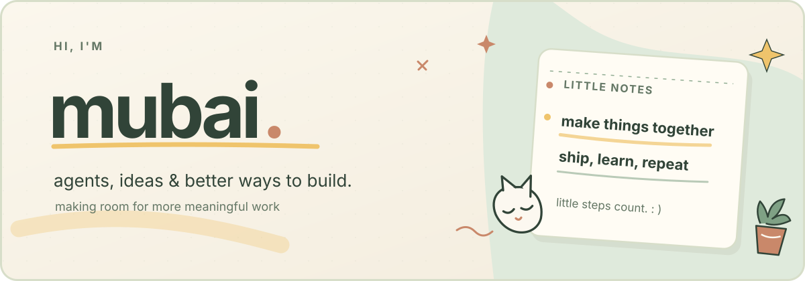

<!-- 木白 · Mubai | GitHub Profile -->

  <picture>
    <source media="(prefers-color-scheme: dark)" srcset="./assets/little-corner-dark.svg" />
    
  </picture>

  <h3>你好，我是木白。 Mubai</h3>
  
喜欢写代码，尤其热衷于 AI Agent（智能体）：研究模型怎样与工具、流程和人协作，也喜欢把脑袋里的小想法做成真正能用的东西。

  
<strong>保持好奇，慢慢生长。🌱</strong>

  
<a href="https://github.com/Fongcy">GitHub</a> · <a href="https://worklog.nuoya.icu/">看看 Worklog</a>

---

## 🌿 最近在折腾

- **🤖 智能体开发与探索**：特别关注 Agent 工具调用、任务编排、多智能体协作和 Human-in-the-loop——智能体遇到问题时，人能如何接管、修正并让流程继续。
- **🛠️ 做点实用的小东西**：正在打磨 [Worklog](https://worklog.nuoya.icu/)，希望工作记录不只是写完就忘。
- **📚 慢慢整理知识**：折腾 Obsidian、RAG 和结构化学习，让学过的东西以后还找得到。

## ☕ 做出来的小作品

### Worklog · 工作复盘台

> 把零散的工作事项，整理成可核对、可修订、可回看的日报和周报。

  <picture>
    <source media="(prefers-color-scheme: dark)" srcset="./assets/worklog-journey-dark.svg" />
    
  </picture>

从**记录事项**，到**整理报告并核对来源**，再到**历史回看、复制和 Markdown 导出**。希望每一步都简单、清楚，结果也有据可查。

**[→ 在线体验 Worklog](https://worklog.nuoya.icu/)**

当前是 v0.2 React / TypeScript / Vite 交互原型。数据主要保存在当前浏览器；报告整理使用固定规则演示，尚未接入真实 AI 模型或后端。上图是功能流程示意，并非实际界面截图。

## ✳️ 我感兴趣的事情

**AI Agents / Agent Orchestration / Tool Calling / Human-in-the-loop / Knowledge Systems**

智能体是我持续投入精力的技术方向。我关注的不只是一次模型回答，而是一个任务怎样被拆解、怎样调用工具、怎样协作和恢复；以及如何让整个过程**可观察、可干预、可验证**。

同时喜欢研究 RAG、知识系统和开发者工具，也会花时间打磨文案、留白与交互细节。

## 🧰 手边的工具

**🤖 智能体与 LLM · Agent stack（持续学习与实践）**

`AI Agent` · `LangChain` · `LangGraph` · `MCP` · `Tool Calling` · `Human-in-the-loop`

**💻 应用与服务开发**

`Python` · `FastAPI` · `TypeScript` · `React` · `Git` · `Docker`

**📚 数据与知识工具**

`Redis` · `MongoDB` · `RAG` · `Obsidian` · `Markdown`

这是正在使用、学习或探索的技术地图，不代表每项都已应用到公开作品中，也不是熟练程度排名。

---

  
<strong>日子慢一点，想法多一点。</strong>

  
Mubai · @Fongcy · A little corner for curious things.

  
<a href="https://github.com/Fongcy/Fongcy/issues">有想法？来聊聊</a>

